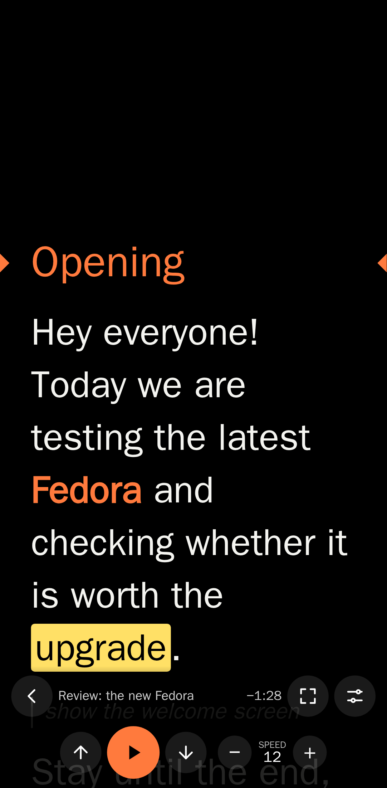
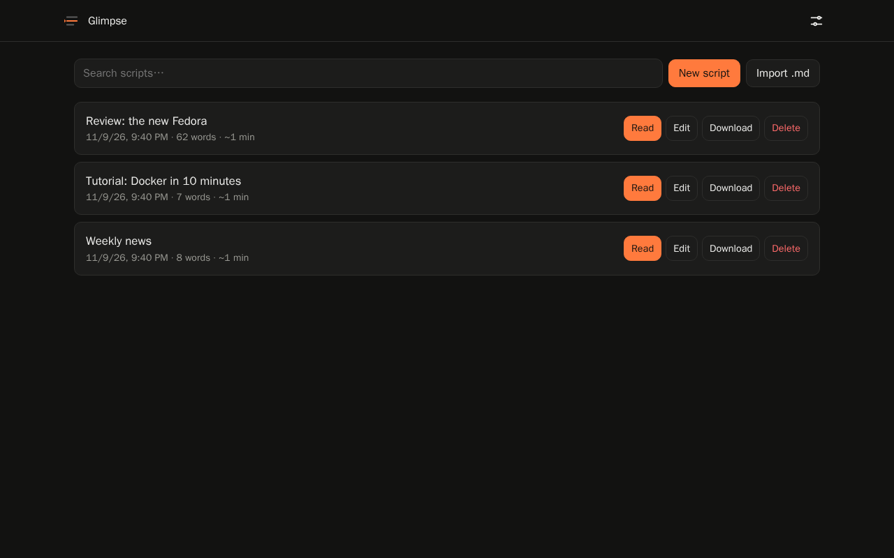
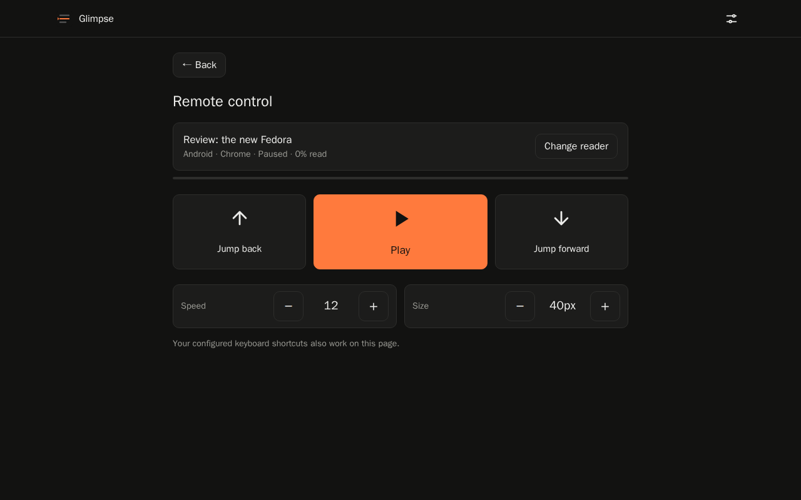
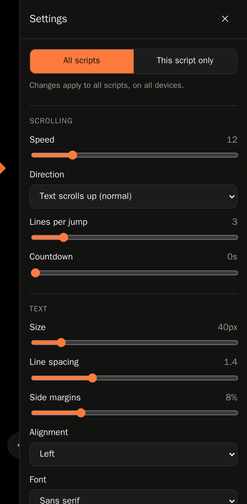

# Glimpse Teleprompter

**English** · [Português](README.pt-BR.md) · [Website](https://dionatansimioni.github.io/glimpse-teleprompter/)

Open source, self-hosted web teleprompter. Upload your scripts in Markdown from your computer and read them on your phone or tablet in the browser, with no app to install.

<p align="center">
  
  
</p>

- **Staging area**: create, edit, import (`.md`, drag and drop) and download scripts, each with its own title.
- **Teleprompter**: speed, text size, line spacing, margins, alignment, font, colors, horizontal and vertical mirroring, scroll direction, reading guide, countdown and time left.
- **Full screen** (and installable as an app with "Add to Home Screen").
- **Universal settings**: text size, speed, mirroring, shortcuts and so on are saved on the server and apply to every script, on any device. When needed, a script can have **custom settings** that override only the items you choose.
- **Customizable shortcuts**: keyboard, Bluetooth remotes (keys, page turners and media buttons) and gamepads.
- **Remote control**: drive the reader on your phone from a laptop or desktop (play/pause, speed, text size, jump back/forward).
- **Touch**: tap the screen to play/pause, drag to move the text.
- **English and Portuguese**: pick the language on the sign-in screen (and switch it later from the menu).
- **Screen stays on** while reading, even without HTTPS.
- Minimal interface with no external runtime dependencies (works on a local network without internet).

## Running with Docker

```bash
mkdir glimpse && cd glimpse
curl -O https://raw.githubusercontent.com/dionatansimioni/glimpse-teleprompter/main/docker-compose.yml
docker compose up -d
```

Open `http://SERVER-IP:3000` in your browser. On the **first access** Glimpse asks you to create the administrator password (with confirmation). After that, sign in with it on your computer, phone and tablet.

> Do the setup right after starting the container: until the password is created, anyone who opens the address can set it.

Or directly with `docker run`:

```bash
docker run -d --name glimpse -p 3000:3000 \
  -v glimpse-data:/data \
  ghcr.io/dionatansimioni/glimpse-teleprompter:latest
```

Images are published to the GitHub Container Registry (`ghcr.io`) for `linux/amd64` and `linux/arm64` (including Raspberry Pi 4/5).

### Environment variables

| Variable | Default | Description |
|---|---|---|
| `PUBLIC_READ` | `false` | `true` lets anyone list and read scripts without signing in (editing still requires signing in). |
| `COOKIE_SECURE` | `false` | Use `true` when Glimpse is accessed over HTTPS. |
| `TRUST_PROXY` | *(empty)* | Number of reverse proxies in front of Glimpse (e.g. `1`), so the sign-in rate limit sees the real client IP. |
| `SESSION_SECRET` | *(generated)* | Session key. If omitted, it is generated and saved to `/data/.session-secret`. |
| `PORT` | `3000` | Internal server port. |
| `DATA_DIR` | `/data` | Where scripts are stored (one JSON file per script). |

All of them are optional.

### Administrator password

- **Create:** on the first access, on the initial setup screen.
- **Change:** top-right menu → **Change password** (asks for the current password, the new one and a confirmation). Other connected devices will need to sign in again.
- **Forgot it:** remove it and restart; the initial setup screen shows up again on the next access. Scripts are not affected.

  ```bash
  docker compose exec glimpse node src/reset-password.js
  docker compose restart glimpse
  ```

The password is stored only as a hash (scrypt) in `/data/auth.json`. Sessions last 30 days.

## How to use

1. On your computer, open `http://server:3000`, sign in (or create the password on the first access) and click **New script** or **Import .md** (or drag files onto the page).
2. On your phone or tablet, open the same address, sign in and tap **Read**.
3. Tap ⚙ to adjust text, speed, mirroring and shortcuts. Use the full screen button or add Glimpse to your home screen.

### Menu and language

The menu in the top-right corner of the library has **Teleprompter settings** (the general settings and shortcuts, without opening a script), **Remote control**, **Language** (Português / English), **Change password** and **Sign out**. The language is also chosen on the sign-in screen and is remembered on each device; if you never choose one, Glimpse follows the browser language.

### Remote control



Control a reader that is open on another device, such as the phone mounted on the camera, from a laptop or desktop:

1. Open the script in the reader on the phone (signed in as administrator).
2. On the computer, open the menu → **Remote control** and pick the reader from the list (if only one is open, it is selected automatically).
3. Use the buttons: **play / pause**, **speed − / +**, **text size − / +** and **jump back / forward**. Your configured keyboard shortcuts work on this page too, so a keyboard or a Bluetooth remote connected to the computer can drive the phone.

The page shows the reader's state (playing or paused, speed, size and how much was read). It works over plain HTTP on your local network; if the connection drops, the phone keeps scrolling on its own and the control reconnects automatically.

<br clear="right">

### General settings vs. a script's custom settings



In the reader's ⚙ panel, choose where changes are saved:

- **All scripts** (default): changes the general settings, which apply to every script and device.
- **This script only**: creates custom settings for the open script, overriding the general settings only for the items you change (marked with ●). Everything else keeps following the general settings.

Each overridden item has a **use general** button, and **Remove this script’s custom settings** clears all of them at once. In the library, scripts with custom settings are labeled *custom settings*. *Keep the screen on*, *Capture media buttons* and shortcuts are always general.

Settings live in `/data/settings.json`, and custom settings inside each script's file. Settings saved in the browser by earlier versions are migrated to the server automatically.

The title of an imported script comes from the front matter (`title: ...`), from the first `# Title`, or from the file name.

### Supported Markdown

```markdown
# Section (highlighted; use , and . to jump between sections)
Regular text, **emphasis**, *italic* and ==highlight==.
> Stage direction: shown smaller and dimmed (e.g. "show the terminal").
---
```

## Default shortcuts

| Action | Keys |
|---|---|
| Play / pause | `Space`, `Enter`, `K`, media button ⏯ |
| Speed − / + | `←` / `→`, `-` / `=` |
| Jump back / forward | `↑` / `↓`, `Page Up` / `Page Down`, media ⏮ / ⏭ |
| Previous / next section | `,` / `.` |
| Start / end | `Home` / `End` |
| Smaller / larger text | `[` / `]` |
| Mirror horizontally / vertically | `M` / `V` |
| Reverse direction | `R` |
| Full screen | `F` |
| Show / hide controls | `H` |
| Settings | `S` |

All of them can be changed in ⚙ → **Shortcuts and controllers** (in the reader) or in **Teleprompter settings** (in the menu): click **+** and press the key or controller button.

### Bluetooth remotes

- **Page turners and mini keyboards** (send arrows, Page Up/Down, Enter, Space): work out of the box or after mapping them with **+**.
- **Media remotes / selfie remotes**: turn on **Capture media buttons** in the settings and press play once. Glimpse plays a silent audio track to receive play/pause, next and previous through the browser's Media Session.
- **Gamepads**: press any button with the page open so the browser detects the controller, then map its buttons with **+**.
- Android **volume** buttons never reach the browser; this is a system limitation.

### Phone notes

- **The screen does not turn off while reading** (*Keep the screen on*, enabled by default). Over HTTPS Glimpse uses the browser's Wake Lock API. When you open it by IP over plain HTTP that API does not exist, so Glimpse switches to *compatibility mode*: an invisible, silent looping video that keeps the phone or computer screen on. This mode starts on the first tap or key press; its status is shown in ⚙ → Screen.
- For the best experience (Wake Lock and unrestricted full screen), put Glimpse behind a reverse proxy with HTTPS (Caddy, Traefik, Nginx Proxy Manager, Tailscale Serve, etc.) and set `COOKIE_SECURE=true`.
- On iPhone, Safari does not offer full screen for web pages; use **Share → Add to Home Screen**.

## Development

Requires Node.js 20 or newer.

```bash
npm install
npm run dev                      # http://localhost:3000
npm test                         # API, page and module tests
npm run test:e2e                 # browser tests (Playwright via Docker; version read from package.json)
npm run screenshots              # regenerates the website screenshots (pt and en)
git config core.hooksPath .githooks   # enables the secret scan (gitleaks) before each commit
```

CI also runs [gitleaks](https://github.com/gitleaks/gitleaks) on the whole history and does not publish the image if it finds tokens, keys or passwords. Local data (`data/`, `.env`, `auth.json`, certificates) is in `.gitignore`.

Layout:

```
src/            server (Express): API, authentication and storage
public/         interface (plain HTML/CSS/JS, no build step)
  js/reader.js  teleprompter
  js/keys.js    shortcuts (keyboard, Bluetooth, gamepad)
  js/settings.js reading settings
  js/i18n.js    languages (js/locales/pt.js and en.js)
  js/remote.js  remote control page (server side: src/remote.js)
site/           project website (GitHub Pages)
scripts/        e2e tests and screenshots via Docker
test/           unit and API tests (node:test)
e2e/            browser tests, desktop and phone (Playwright)
```

Every push to `main` runs the tests on GitHub Actions and publishes the image to `ghcr.io/dionatansimioni/glimpse-teleprompter:latest`. `vX.Y.Z` tags produce versioned `X.Y.Z` and `X.Y` images. The website in `site/` is published to GitHub Pages.

### Translations

Strings live in `public/js/locales/pt.js` and `en.js` (same keys in both). The tests check that every key exists in both languages with the same parameters, and that every key used in the HTML and JavaScript exists.

## License

[MIT](LICENSE)
