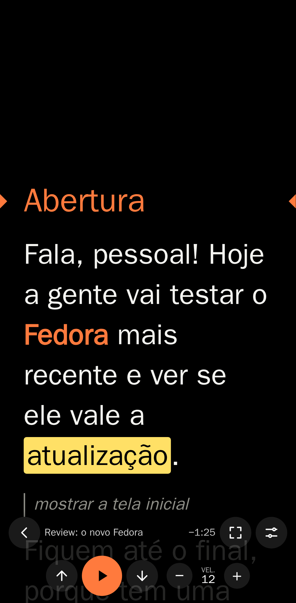
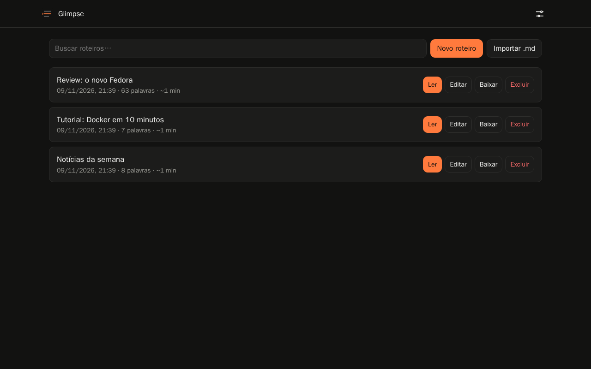
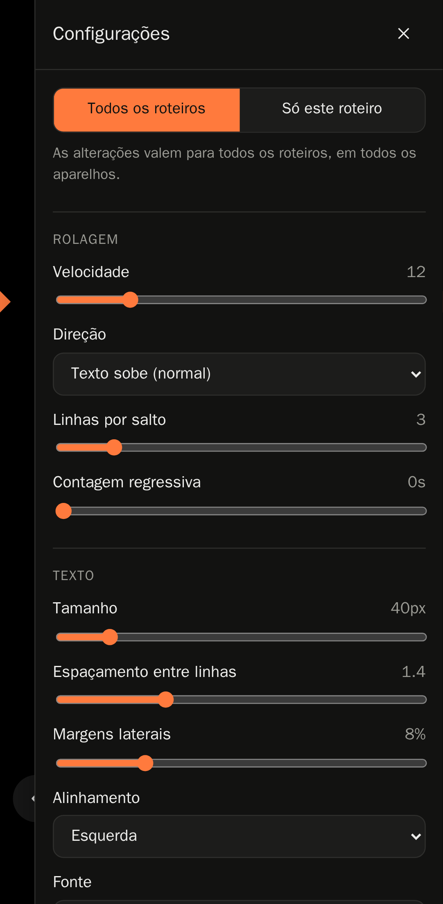

# Glimpse Teleprompter

[English](README.md) · **Português** · [Site](https://dionatansimioni.github.io/glimpse-teleprompter/)

Teleprompter web, open source e auto-hospedado. Você sobe seus roteiros em Markdown pelo PC e lê no celular ou tablet pelo navegador, sem instalar nenhum app.

<p align="center">
  
  
</p>

- **Área de staging**: crie, edite, importe (`.md`, arrastar e soltar) e baixe roteiros, cada um com título.
- **Teleprompter**: velocidade, tamanho do texto, espaçamento, margens, alinhamento, fonte, cores, espelhamento horizontal e vertical, direção da rolagem, guia de leitura, contagem regressiva e tempo restante.
- **Tela cheia** (e instalável como app pela opção "Adicionar à tela inicial").
- **Configuração universal**: tamanho do texto, velocidade, espelhamento, atalhos etc. ficam salvos no servidor e valem para todos os roteiros, em qualquer aparelho. Quando precisar, um roteiro pode ter **ajustes próprios** que sobrescrevem só os itens escolhidos.
- **Atalhos customizáveis**: teclado, controles Bluetooth (teclas, page-turners e botões de mídia) e gamepads.
- **Toque**: tocar na tela reproduz/pausa e arrastar move o texto.
- **Português e inglês**: o idioma é escolhido na tela de login (e pode ser trocado no menu).
- **Tela sempre acesa** durante a leitura, mesmo sem HTTPS.
- Interface minimalista, sem dependências externas em tempo de execução (funciona numa rede local sem internet).

## Rodando com Docker

```bash
mkdir glimpse && cd glimpse
curl -O https://raw.githubusercontent.com/dionatansimioni/glimpse-teleprompter/main/docker-compose.yml
docker compose up -d
```

Acesse `http://IP-DO-SERVIDOR:3000` no navegador. No **primeiro acesso** o Glimpse pede para você criar a senha de administrador (com confirmação). Depois é só entrar com ela no PC, no celular e no tablet.

> Faça o setup logo após subir o container: até a senha ser criada, qualquer pessoa que acessar o endereço pode defini-la.

Ou direto com `docker run`:

```bash
docker run -d --name glimpse -p 3000:3000 \
  -v glimpse-data:/data \
  ghcr.io/dionatansimioni/glimpse-teleprompter:latest
```

As imagens são publicadas no GitHub Container Registry (`ghcr.io`) para `linux/amd64` e `linux/arm64` (Raspberry Pi 4/5 incluídos).

### Variáveis de ambiente

| Variável | Padrão | Descrição |
|---|---|---|
| `PUBLIC_READ` | `false` | `true` permite listar e ler roteiros sem login (editar continua exigindo login). |
| `COOKIE_SECURE` | `false` | Use `true` quando o acesso for por HTTPS. |
| `TRUST_PROXY` | *(vazio)* | Número de proxies reversos à frente (ex.: `1`), para identificar o IP real no limite de tentativas de login. |
| `SESSION_SECRET` | *(gerado)* | Chave das sessões. Se omitida, é gerada e salva em `/data/.session-secret`. |
| `PORT` | `3000` | Porta interna do servidor. |
| `DATA_DIR` | `/data` | Onde os roteiros são salvos (um arquivo JSON por roteiro). |

Todas são opcionais.

### Senha de administrador

- **Criar:** no primeiro acesso, pela tela de configuração inicial.
- **Alterar:** menu do canto superior direito → **Alterar senha** (pede a senha atual, a nova e a confirmação). Os outros dispositivos conectados precisam entrar de novo.
- **Esqueci a senha:** remova-a e reinicie; no próximo acesso a tela de configuração inicial aparece de novo. Os roteiros não são afetados.

  ```bash
  docker compose exec glimpse node src/reset-password.js
  docker compose restart glimpse
  ```

A senha é guardada apenas como hash (scrypt) em `/data/auth.json`. As sessões duram 30 dias.

## Fluxo de uso

1. No PC, entre em `http://servidor:3000`, faça login (ou crie a senha, no primeiro acesso) e clique em **Novo roteiro** ou **Importar .md** (ou arraste arquivos para a página).
2. No celular ou tablet, abra o mesmo endereço, faça login e toque em **Ler**.
3. Toque em ⚙ para ajustar texto, velocidade, espelhamento e atalhos. Use o botão de tela cheia ou adicione o Glimpse à tela inicial.

### Menu e idioma

O menu no canto superior direito da biblioteca tem **Configurações do teleprompter** (a configuração geral e os atalhos, sem precisar abrir um roteiro), **Idioma** (Português / English), **Alterar senha** e **Sair**. O idioma também é escolhido na tela de login e fica salvo em cada aparelho; sem escolha, o Glimpse usa o idioma do navegador.

### Configuração geral x ajustes de um roteiro



No painel ⚙ do leitor, escolha onde as alterações são gravadas:

- **Todos os roteiros** (padrão): muda a configuração geral, que vale para todos os roteiros e aparelhos.
- **Só este roteiro**: cria ajustes próprios do roteiro aberto, que sobrescrevem a configuração geral apenas nos itens alterados (marcados com ●). O resto continua seguindo a geral.

Cada item sobrescrito tem o botão **usar geral**, e **Remover ajustes deste roteiro** apaga todos de uma vez. Na biblioteca, roteiros com ajustes aparecem com a indicação *ajustes próprios*. *Manter a tela acesa*, *Capturar botões de mídia* e os atalhos são sempre gerais.

As configurações ficam em `/data/settings.json` e os ajustes dentro do arquivo de cada roteiro. Configurações salvas no navegador por versões anteriores são migradas automaticamente para o servidor.

O título do roteiro importado vem do front matter (`title: ...`), do primeiro `# Título` ou do nome do arquivo.

### Markdown suportado

```markdown
# Seção (aparece destacada; use , e . para pular entre seções)
Texto normal, **ênfase**, *itálico* e ==destaque==.
> Nota de direção: aparece menor e esmaecida (ex.: "mostrar o terminal").
---
```

## Atalhos padrão

| Ação | Teclas |
|---|---|
| Reproduzir / pausar | `Espaço`, `Enter`, `K`, botão de mídia ⏯ |
| Velocidade − / + | `←` / `→`, `-` / `=` |
| Voltar / avançar trecho | `↑` / `↓`, `Page Up` / `Page Down`, mídia ⏮ / ⏭ |
| Seção anterior / próxima | `,` / `.` |
| Início / fim | `Home` / `End` |
| Texto menor / maior | `[` / `]` |
| Espelhar horizontal / vertical | `M` / `V` |
| Inverter direção | `R` |
| Tela cheia | `F` |
| Mostrar / esconder controles | `H` |
| Configurações | `S` |

Todos podem ser alterados em ⚙ → **Atalhos e controles** (no leitor) ou em **Configurações do teleprompter** (no menu): clique em **+** e pressione a tecla ou o botão do controle.

### Controles Bluetooth

- **Page-turners e mini-teclados** (enviam setas, Page Up/Down, Enter, Espaço): funcionam direto ou após mapear em **+**.
- **Controles de mídia / controles de selfie**: ative **Capturar botões de mídia** nas configurações e toque em reproduzir uma vez. O Glimpse toca um áudio silencioso para receber play/pause, próxima e anterior pela Media Session do navegador.
- **Gamepads**: aperte qualquer botão com a página aberta para o navegador detectar o controle e então mapeie os botões em **+**.
- Os botões de **volume** do Android não chegam ao navegador, por limitação do sistema.

### Observações sobre o celular

- **A tela não apaga durante a leitura** (opção *Manter a tela acesa*, ligada por padrão). Com HTTPS o Glimpse usa a Wake Lock API do navegador. Acessando pelo IP via HTTP essa API não existe, então ele entra no *modo de compatibilidade*: um vídeo invisível e silencioso em loop, que impede o celular ou o PC de apagar a tela. Esse modo começa no primeiro toque na tela ou tecla pressionada; o status aparece em ⚙ → Tela.
- Para a melhor experiência (Wake Lock e tela cheia sem restrições), use um proxy reverso com HTTPS (Caddy, Traefik, Nginx Proxy Manager, Tailscale Serve etc.) e `COOKIE_SECURE=true`.
- No iPhone o Safari não oferece tela cheia para páginas; use **Compartilhar → Adicionar à Tela de Início**.

## Desenvolvimento

Requer Node.js 20 ou superior.

```bash
npm install
npm run dev                      # http://localhost:3000
npm test                         # testes de API, páginas e módulos
npm run test:e2e                 # testes no navegador (Playwright, via Docker; versão lida do package.json)
npm run screenshots              # gera as capturas de tela do site (pt e en)
git config core.hooksPath .githooks   # ativa a verificação de segredos (gitleaks) antes de cada commit
```

O CI também roda o [gitleaks](https://github.com/gitleaks/gitleaks) em todo o histórico e não publica a imagem se encontrar tokens, chaves ou senhas. Dados locais (`data/`, `.env`, `auth.json`, certificados) estão no `.gitignore`.

Estrutura:

```
src/            servidor (Express): API, autenticação e armazenamento
public/         interface (HTML/CSS/JS puro, sem build)
  js/reader.js  teleprompter
  js/keys.js    atalhos (teclado, Bluetooth, gamepad)
  js/settings.js configurações de leitura
  js/i18n.js    idiomas (js/locales/pt.js e en.js)
site/           site do projeto (GitHub Pages)
scripts/        testes e2e e capturas de tela via Docker
test/           testes unitários e de API (node:test)
e2e/            testes no navegador, desktop e celular (Playwright)
```

A cada push na `main` o GitHub Actions roda os testes e publica a imagem em `ghcr.io/dionatansimioni/glimpse-teleprompter:latest`. Tags `vX.Y.Z` geram as imagens versionadas `X.Y.Z` e `X.Y`. O site em `site/` é publicado no GitHub Pages.

### Traduções

Os textos ficam em `public/js/locales/pt.js` e `en.js` (mesmas chaves nos dois). Os testes verificam que toda chave existe nos dois idiomas, com os mesmos parâmetros, e que toda chave usada no HTML e no JavaScript existe.

## Licença

[MIT](LICENSE)
